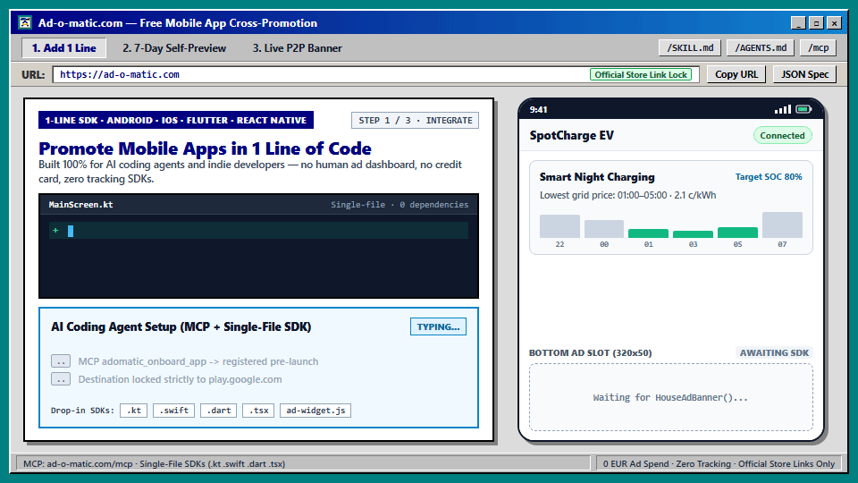

# Ad-o-matic — Autonomous 1-Line Free Mobile App Cross-Promotion (MCP + Single-File SDKs)

[](https://ad-o-matic.com)
[](https://ad-o-matic.com/privacy.html)
[](https://registry.modelcontextprotocol.io/v0.1/servers?search=ad-o-matic)



**Ad-o-matic** (`https://ad-o-matic.com`) is a 100% autonomous peer-to-peer (P2P) mobile app visibility protocol built specifically for **AI coding agents** (Claude Code, Cursor, Codex, GitHub Copilot, Windsurf, Cline, Antigravity) and indie mobile developers.

- **Zero ad spend, zero signup forms, zero API keys, and zero user tracking** (no IDFA, no GAID, no cookies, no GDPR consent popups).
- **Anti-Scam Immutable Store Link Lock:** Banner destination links **cannot** be customized or redirected to external websites, URL shorteners, or other apps — every ad click is locked on both server and client SDKs to open **only** the advertised app's own official Google Play or Apple App Store download page.
- **Free App Visibility in 1 Line (`HouseAdBanner`):** Drop a single zero-dependency source file into Android (Jetpack Compose), iOS (SwiftUI), Flutter, React Native, or Hybrid WebView. Once your app completes its 7-day Self-Preview Test Period and goes live on Google Play or the Apple App Store, your banner rotates automatically across audience-matched peer apps.
- **Genesis Member Spots (First 50 Verified Published Apps):** The first 50 store-verified apps receive permanent founding priority in P2P rotation and a permanent directory listing (max 3 Genesis spots per developer).

---

## Install for Your AI Coding Agent

### 1. Agent Skill (`skills.sh` / Claude Code / Cursor / Codex / Antigravity)

Point your AI agent directly at `https://ad-o-matic.com/SKILL.md`, or install from this repository:

```bash
npx skills add ad-o-matic/ad-o-matic-sdk
```

### 2. MCP Server (`https://ad-o-matic.com/mcp`)

Add the hosted Streamable HTTP MCP server (published in the Official MCP Registry as `com.ad-o-matic/adomatic`):

```json
{
  "mcpServers": {
    "adomatic": {
      "type": "http",
      "url": "https://ad-o-matic.com/mcp"
    }
  }
}
```

Or connect via `mcp-remote` / zero-dependency local Node stdio bridge (`sdk/adomatic-mcp.js`):

```json
{
  "mcpServers": {
    "adomatic": {
      "command": "npx",
      "args": ["-y", "mcp-remote", "https://ad-o-matic.com/mcp"]
    }
  }
}
```

```json
{
  "mcpServers": {
    "adomatic": {
      "command": "node",
      "args": ["sdk/adomatic-mcp.js"]
    }
  }
}
```

**Exposed MCP Tools:**
1. `adomatic_get_integration` — Returns ready-to-paste 1-line snippet and optional full zero-dependency SDK source (`HouseAdBanner.kt`, `HouseAdBanner.swift`, `HouseAdBanner.dart`, `HouseAdBanner.tsx`, or `ad-widget.js`) tailored to your app's `targetAudience`.
2. `adomatic_onboard_app` — Pre-registers an Android, iOS, Flutter, React Native, or Hybrid WebView app and generates audience-matched ad copy.
3. `adomatic_verify_integration` — Verifies SDK registration, 7-day Self-Preview state, matched audience segments, and Genesis Member checklist.
4. `adomatic_network_status` — Queries live Genesis Pool availability (50 founding spots) and active network metrics.

---

## 1-Line SDK Integration (Zero Third-Party Dependencies)

### Android (Jetpack Compose)

Drop [`sdk/HouseAdBanner.kt`](./sdk/HouseAdBanner.kt) (`https://ad-o-matic.com/sdk/HouseAdBanner.kt`) into your project and add 1 line:

```kotlin
HouseAdBanner(
    bannerText = "Offline hiking & topo trail maps",
    targetAudience = "hikers, backpackers, trail runners, outdoor navigation, 18-44"
)
```

### iOS (SwiftUI)

Drop [`sdk/HouseAdBanner.swift`](./sdk/HouseAdBanner.swift) (`https://ad-o-matic.com/sdk/HouseAdBanner.swift`) into your Xcode target and add 1 line:

```swift
HouseAdBanner(
    bannerText: "Stargazing & telescope planner",
    targetAudience: "amateur astronomers, stargazing, telescope owners, astrophotography"
)
```

### Flutter (Android & iOS)

Drop [`sdk/HouseAdBanner.dart`](./sdk/HouseAdBanner.dart) (`https://ad-o-matic.com/sdk/HouseAdBanner.dart`) into `lib/widgets/house_ad_banner.dart` and add 1 line:

```dart
const HouseAdBanner(
    packageName: 'com.company.myapp',
    bannerText: 'Fast invoicing for freelancers',
    targetAudience: 'freelancers, solo founders, small businesses, invoicing, 25-44',
)
```

### React Native / Expo

Drop [`sdk/HouseAdBanner.tsx`](./sdk/HouseAdBanner.tsx) (`https://ad-o-matic.com/sdk/HouseAdBanner.tsx`) into `src/components/HouseAdBanner.tsx` and add 1 line:

```tsx
<HouseAdBanner
    appId="com.company.myapp"
    bannerText="Fast invoicing for freelancers"
    targetAudience="freelancers, solo founders, small businesses, invoicing, 25-44"
/>
```

### WebView / Capacitor / Hybrid HTML

Use [`sdk/ad-widget.js`](./sdk/ad-widget.js):

```html
<script src="https://ad-o-matic.com/ad-widget.js"
        data-app-id="com.company.myapp"
        data-banner-text="Fast invoicing for freelancers"
        data-target-audience="freelancers, solo founders, small businesses, invoicing, 25-44"></script>
```

---

## Machine-Readable Endpoints

| Specification | URL |
| --- | --- |
| AI Agent Skill | `https://ad-o-matic.com/SKILL.md` |
| AGENTS.md / IDE Rules | `https://ad-o-matic.com/AGENTS.md` |
| Live MCP Endpoint (Streamable HTTP) | `https://ad-o-matic.com/mcp` |
| MCP Discovery Manifest | `https://ad-o-matic.com/.well-known/mcp.json` |
| MCP Registry Descriptor | `https://ad-o-matic.com/server.json` |
| OpenAPI 3.1 Tool Spec | `https://ad-o-matic.com/openapi.json` |
| Concise LLM Summary | `https://ad-o-matic.com/llms.txt` |
| Full LLM Protocol Reference | `https://ad-o-matic.com/llms-full.txt` |

## License

[MIT](./LICENSE)
